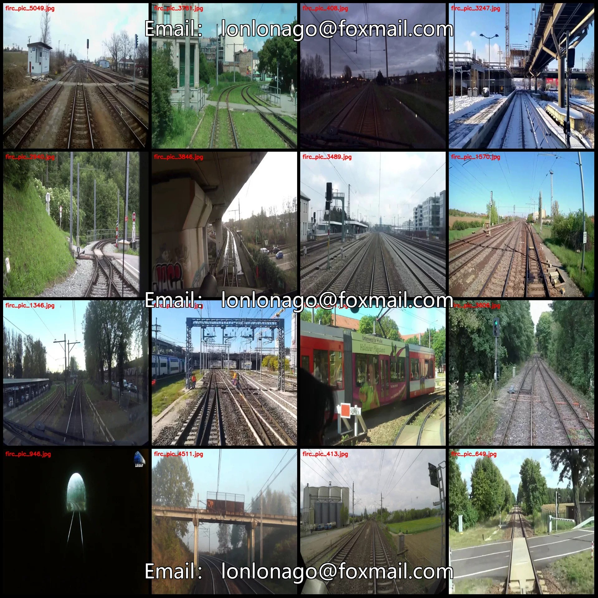
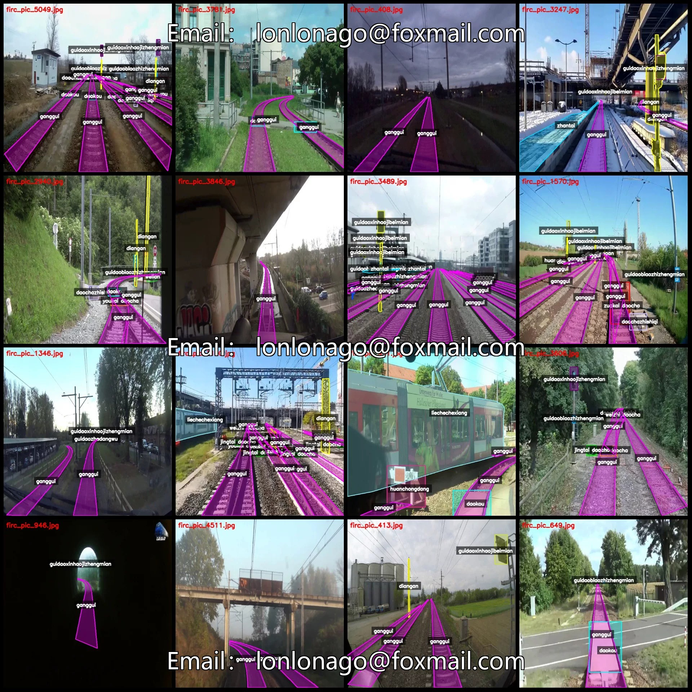
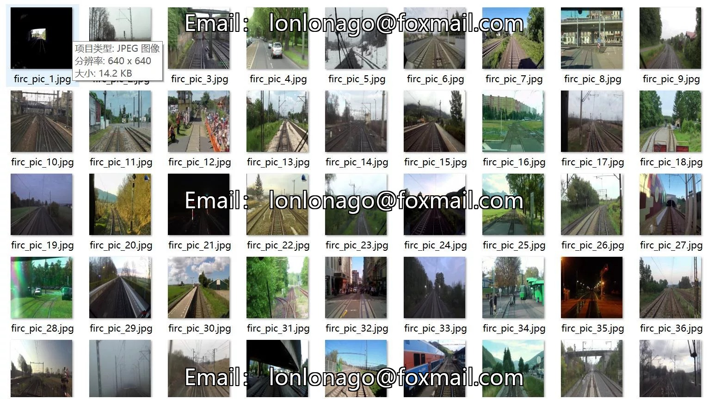
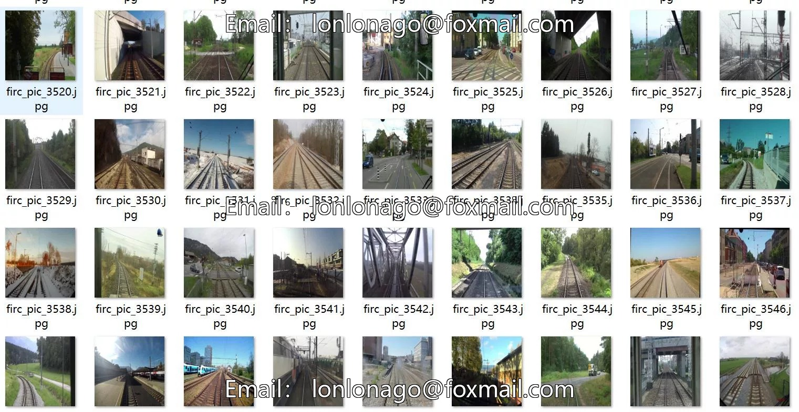
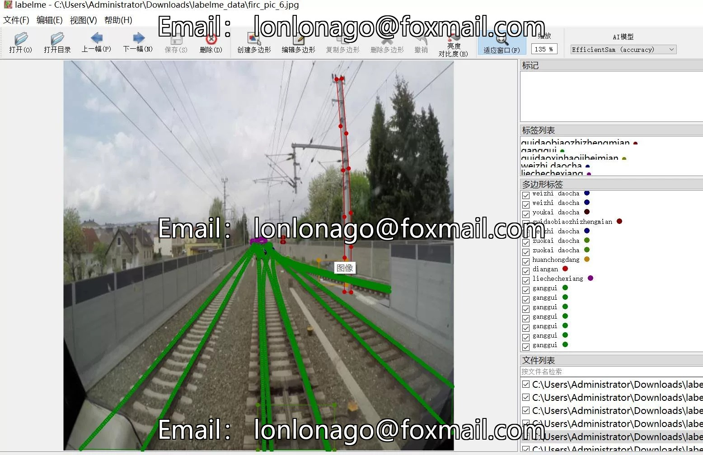

# Intelligent Railway Track Elements Signal Marker Identification and Segmentation Dataset in LabelMe Format

## Body

Smart Railway Track Elements Signal Marker Identification and Segmentation Data Set - LabelMe format: 5092 images, 20 categories
Warm Reminder: Due to the dataset's replicability, please confirm compliance with requirements before purchasing.
Dataset format: LabelMe format (excluding mask files, only including jpg images and corresponding json files)
Number of images (number of jpg files): 5092
Number of annotations (number of json files): 5092
Number of annotation categories: 20

Label category names: ["chexiang", "daochazhishiqi", "daokou", "diangan", "ganggui", "guidaobiaozhizhengmian", "guidaoxinhaojibeimian", "guidaoxinhaojizhengmian", "guidaozhedangwu", "huanchongdang", "huoche", "jingtai daocha", "liechechexiang", "ren", "renqun", "weilan", "weizhi d"]

aocha","youkai daocha","zhantai","zuokai daocha

["Carriage", "Turnout Indicator", "Turnout", "Electric Pole", "Railway Track", "Facing of Railway Sign", "Rear of Railway Sign", "Facing of Railway Sign", "Railway Obstruction", "Buffer Stop", "Freight Car", "Static Turnout", "Train Cargo", "Person", "Group", "Fence", "Unknown Turnout", "Right-turning Turnout", "Platform", "Left-turning Turnout"]
Number of boxes and the number of images occupied by each category
Chexiang frame count = 109, occupying picture count = 80
Daochazhishiqi frame count = 1280, occupying image count = 671

daokou frame count = 1700, occupied image count = 864
diangan frame count = 6429, occupied image count = 1921
ganggui frame count = 17085, occupied image count = 5091
guidao benchmark surface frame count = 4355, occupied image count = 2179
guidao new good face front surface frame count = 2000, occupied image count = 912
guidao new good face back surface frame count = 3458, occupied image count = 1613
guidao standard work frame count = 2340, occupied image count = 1051

huanchongdang frame count = 139, occupying image count = 109
huoche frame count = 8, occupying image count = 8
jingtai daocha frame count = 1480, occupying image count = 844
liechechexiang frame count = 1192, occupying image count = 828
ren frame count = 136, occupying image count = 91
renqun frame count = 35, occupying image count = 27
weilan frame count = 177, occupying image count = 158
weizhi daocha frame count = 1508, occupying image count = 925
youkai daocha frame count = 1313, occupying image count = 943

Zhan Tai Frames = 1455, occupied images = 892
Zuo Kai Docha Frames = 1196, occupied images = 875
Total Frames: 47395
Using labelme tool: labelme=5.5.0
Image resolution: 640x640
Annotation rules: Polygonize the category with polygon
Important Note: The dataset can be opened and edited using labelme, while the json dataset needs to be converted into mask or yolo format or coco format for semantic segmentation or instance segmentation.
Special Remark: This dataset does not guarantee the accuracy of the trained model or weight files.

## Images

## Payment

Here is a pay link on Stripe ( https://buy.stripe.com/3cs8yP7sY87d0vu9AB ). Please contact me lonlonago@foxmail.com after funding $89, and I will send you a complete data files , thank you!

